# Airbnb Clone

A full-stack clone of Airbnb's core experience: explore and search stays, view a listing, book dates with a mocked checkout, manage trips and wishlists, and host your own listings.

**Stack:** Next.js 16 (TypeScript, Tailwind CSS) · FastAPI (Python) · SQLite (SQLAlchemy 2)

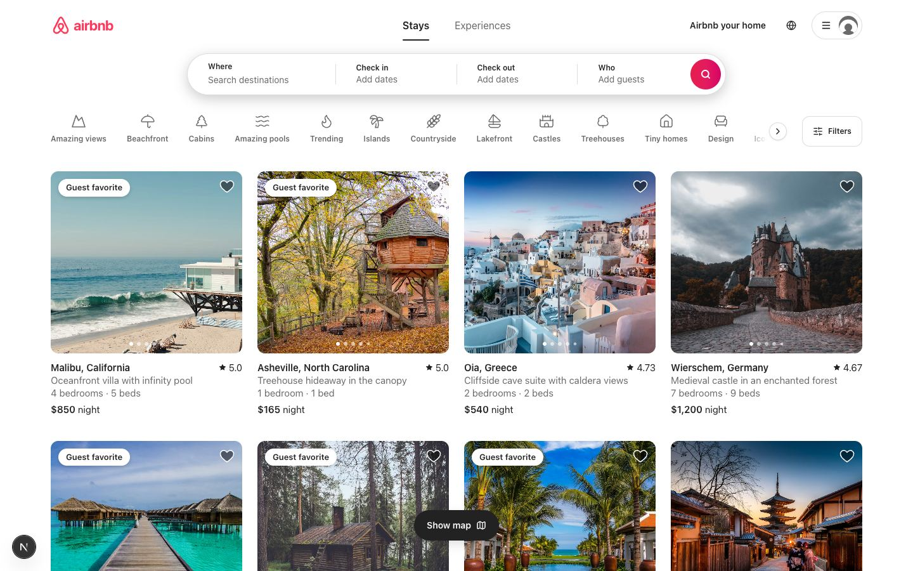

| Listing page | Checkout |
| --- | --- |
| 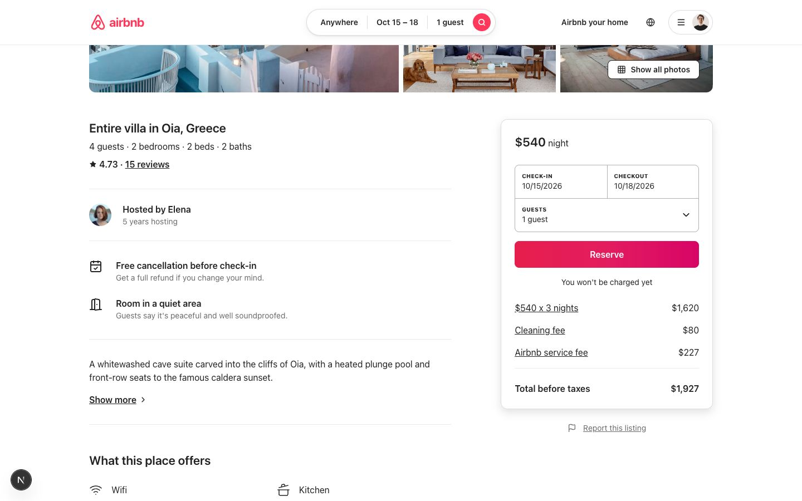 | 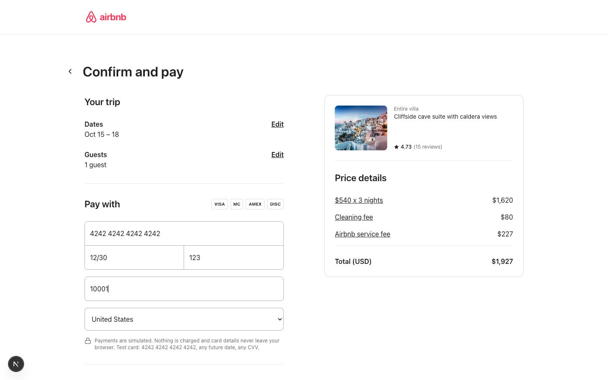 |
| **Filters** | **Map view** |
| 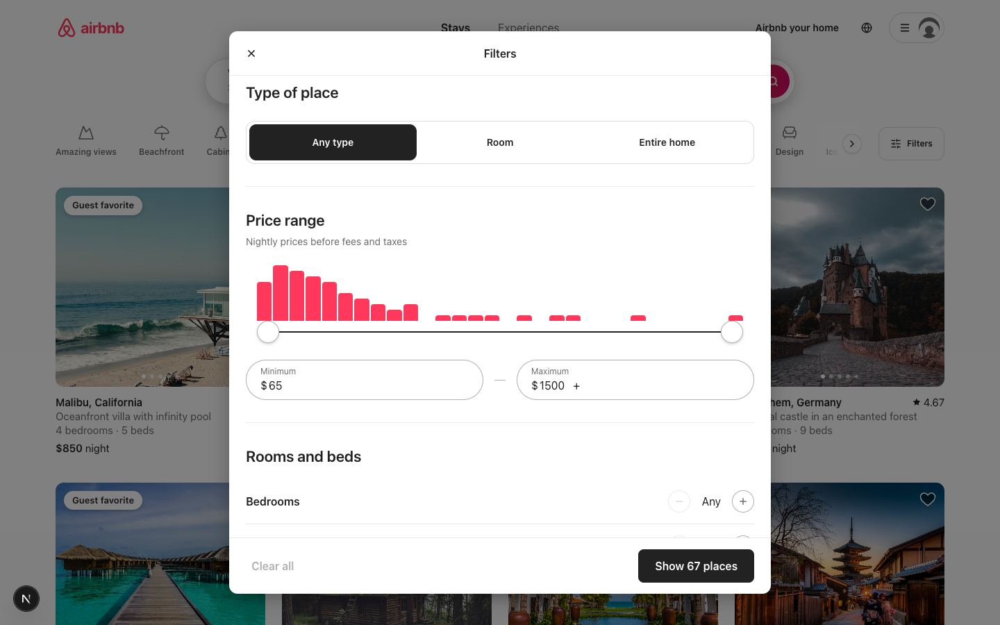 | 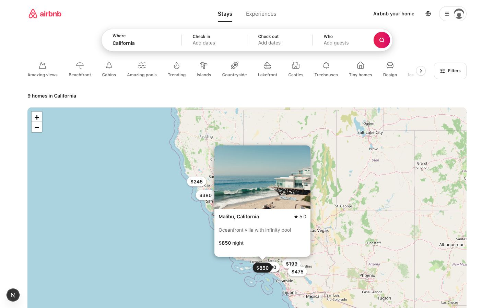 |
| **Trips** | **Host dashboard** |
| 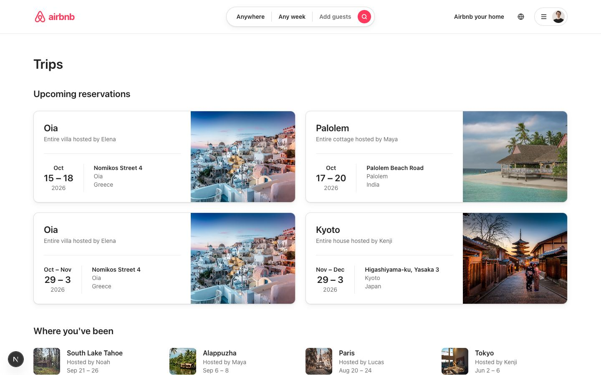 | 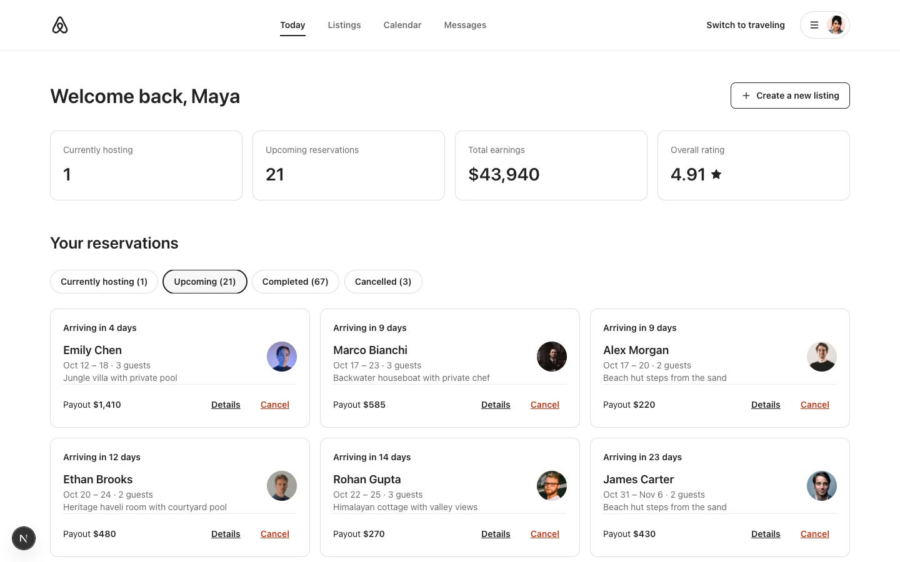 |
| **Listing wizard** | **Dark mode** |
| 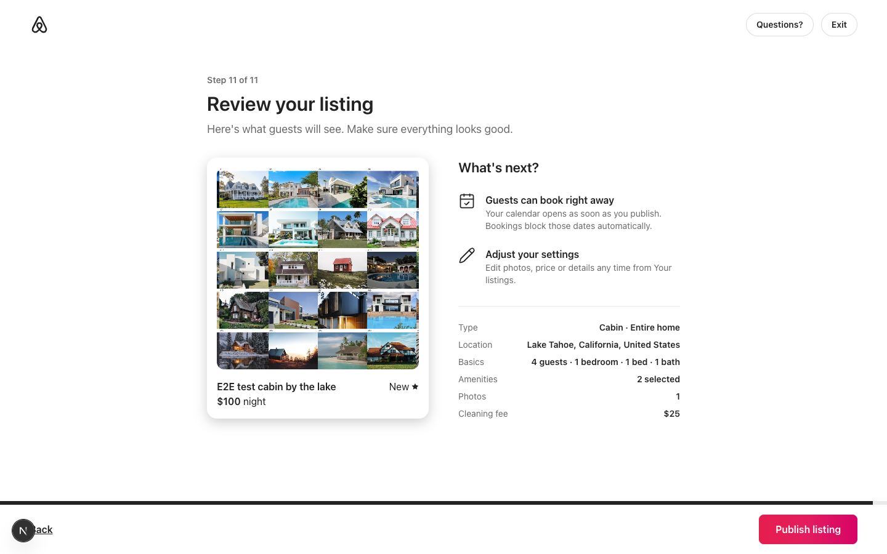 | 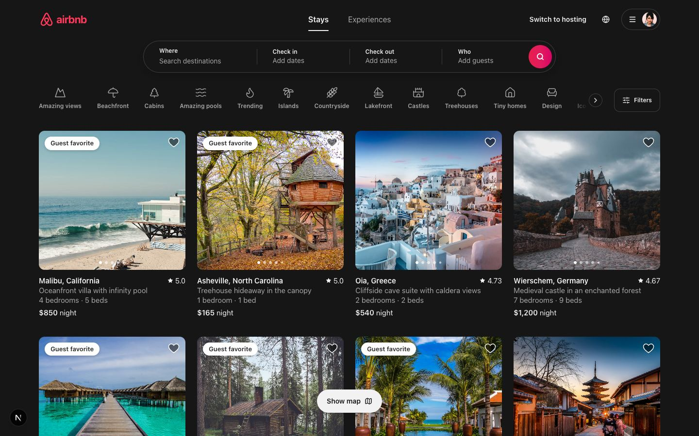 |

---

## Quick start

Requirements: **Python 3.10+** and **Node.js 20.9+**.

```bash
# macOS / Linux
./start.sh            # installs what's missing, then runs both servers
./start.sh --reset    # same, but wipes the database and reloads the demo data
```

```bat
:: Windows (Command Prompt or PowerShell, or double-click start.bat)
start.bat
start.bat --reset
```

- App: http://localhost:3000
- API docs (Swagger): http://localhost:8000/docs
- Press `Ctrl+C` to stop both servers.

You're **logged in as the demo guest automatically** on your first visit, and the checkout form comes with a test card filled in, so you can book in a couple of clicks. To switch accounts, log out and use the "Continue as demo ..." buttons. After logging out, the app remembers it and doesn't log you back in. Turn auto-login off with `AUTO_LOGIN_EMAIL` in `frontend/src/lib/constants.ts`.

**Demo accounts** (login is passwordless):

| Email | Role | What to try |
| --- | --- | --- |
| `guest@demo.com` | Guest (Alex) | Upcoming trips, past stays waiting for a review, saved wishlist |
| `host@demo.com` | Host (Maya) | 6 listings in India and Bali, a guest staying right now, upcoming reservations |

You can also sign up with any email address.

### Manual setup (what the start scripts do)

Run the backend and the frontend in two separate terminals.

**macOS / Linux**

```bash
# Terminal 1: backend
cd backend
python3 -m venv .venv                       # once
.venv/bin/pip install -r requirements.txt   # once, and after requirements.txt changes
.venv/bin/python -m app.seed                # optional: reset + seed the database
.venv/bin/uvicorn app.main:app --reload     # http://localhost:8000

# Terminal 2: frontend
cd frontend
npm install                                 # once
cp .env.example .env.local                  # once: NEXT_PUBLIC_API_URL=http://localhost:8000
npm run dev                                 # http://localhost:3000
```

**Windows (PowerShell)**

```powershell
# Terminal 1: backend
cd backend
python -m venv .venv                                  # once (or: py -m venv .venv)
.venv\Scripts\python -m pip install -r requirements.txt  # once, and after requirements.txt changes
.venv\Scripts\python -m app.seed                      # optional: reset + seed the database
.venv\Scripts\python -m uvicorn app.main:app --reload # http://localhost:8000

# Terminal 2: frontend
cd frontend
npm install                                           # once
copy .env.example .env.local                          # once
npm run dev                                           # http://localhost:3000
```

Stop each server with `Ctrl+C` in its terminal.

The backend creates `backend/airbnb.db` and seeds demo data automatically the first time it starts.

### Tests and checks

```bash
cd backend && .venv/bin/python -m pytest      # 39 API and business-rule tests
cd frontend && npm run lint && npm run build  # ESLint + type check + production build
```

---

## Features

| Requirement | Where it lives |
| --- | --- |
| **Home & search**: listing grid (photo carousel, title, location, price/night, rating), search bar (location + date range + guests), category row, filters (price histogram + slider, type of place, rooms & beds, amenities, property type), infinite scroll | `frontend/src/components/explore`, `components/search` |
| **Listing page**: photo gallery + full photo tour, description, amenities, host card, availability calendar, price breakdown, reviews with category ratings, map | `frontend/src/components/listing` |
| **Booking flow**: date + guest selection with validation, blocked dates, quote, "Confirm and pay" mock checkout, confirmation page, My Trips, cancellation | `components/listing/BookingCard.tsx`, `components/booking`, `components/trips` |
| **Host CRUD**: 11-step "Airbnb your home" wizard (create + edit), photo upload or URL, map pin, delete, dashboard with reservations and earnings | `frontend/src/components/host` |
| **Airbnb experience**: Airbnb-style header that collapses on scroll, cards, galleries, date pickers, modals, toasts, wishlist hearts | `components/layout`, `components/ui` |
| **Mocked / placeholder**: payments (card validated in the browser only), messages, notifications, identity verification, social login, experiences | `components/booking/CheckoutView.tsx`, `components/ui/ComingSoon.tsx` |
| **Bonus**: interactive map with price pins, reviews after completed stays, Superhost + Guest favorite badges, dark mode, responsive layout (phone tab bar, mobile search) | `components/map`, `components/trips/ReviewModal.tsx`, `lib/theme.ts` |

---

## Project structure: where to change what

```
backend/
  app/
    main.py            FastAPI app: CORS, routers, /uploads static files, auto-seed on startup
    config.py          Settings from environment variables
    database.py        Engine, session, SQLite foreign keys
    deps.py            Shared dependencies: DB session, current user from the JWT
    security.py        Create / read login tokens (JWT)
    errors.py          Readable HTTP errors (NotFound, Conflict, ...)
    models/            Database tables, one file per table (booking.py also holds the overlap triggers)
    schemas/           Request / response shapes (Pydantic)
    routers/           HTTP endpoints, one file per resource
    services/          Business rules
      pricing.py         Price calculation (service fee rate lives here)
      availability.py    Date overlap logic
      booking_service.py Booking validation, create, cancel
      listing_search.py  Search filters
      listing_service.py Listing create / update / delete
      review_service.py  Reviews and rating aggregates
      host_service.py    Superhost status, dashboard stats
    seed/              Demo data (data.py) and the seeding script (seed.py)
  tests/               Pytest suite
frontend/
  src/
    app/               Pages (Next.js App Router). (main)/ = guest pages with header + footer, host/ = hosting area
    components/
      explore/         Home grid, cards, category bar, filters modal
      search/          Search bar, compact pill, mobile search
      listing/         Listing page sections and the booking card
      booking/         Checkout page, price breakdown
      trips/           Trips, trip detail, review form, wishlists
      host/            Host dashboard, listings table, wizard/ (one file per step)
      map/             Leaflet maps (loaded in the browser only)
      layout/          Header, footer, user menu, phone tab bar
      ui/              Reusable pieces: Modal, DateRangePicker, Counter, Avatar, ...
    context/           Logged-in user, wishlist, toasts
    hooks/             Data hooks (infinite listings, price quote, search draft, ...)
    lib/               API client (api.ts), types, formatting, search URL helpers, icons
start.sh               Starts backend + frontend together (macOS / Linux)
start.bat, start.ps1   Same for Windows (start.bat runs start.ps1)
```

Common changes:

| Change | File |
| --- | --- |
| Service fee percentage | `backend/app/services/pricing.py` |
| Booking rules (max nights, guest limits) | `backend/app/services/booking_service.py` |
| Superhost / Guest favorite thresholds | `backend/app/services/host_service.py`, `backend/app/models/listing.py` |
| Demo listings, users, photos | `backend/app/seed/data.py` |
| Colors, fonts, breakpoints, dark theme | `frontend/src/app/globals.css` |
| API base URL | `frontend/.env.local` (`NEXT_PUBLIC_API_URL`) |
| Automatic demo login (on / off / which account) | `frontend/src/lib/constants.ts` (`AUTO_LOGIN_EMAIL`) |
| Any API call | `frontend/src/lib/api.ts` |

---

## Architecture

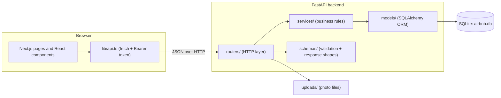

- **Frontend.** Pages are thin and render client components that call the API through `lib/api.ts`. The search state (location, dates, guests, category, filters) lives in the URL, so results are shareable and survive a refresh. Shared state (logged-in user, wishlist, toasts) lives in React context.
- **Backend.** Layered: routers parse the request and return Pydantic schemas, services hold the rules, and models map tables. Validation errors return 422; business errors return 400, 401, 403, 404 or 409 with a readable `detail` message that the UI shows in a toast.
- **Auth (mocked).** Passwordless email login returns a signed JWT that the browser keeps in `localStorage` and sends as `Authorization: Bearer <token>`. Every user can travel; creating a first listing sets `is_host`.

### Booking integrity

1. `GET /listings/{id}/availability` returns booked ranges, so the calendar strikes out taken nights. After a check-in is picked, checkout cannot go past the next booked night.
2. `GET /listings/{id}/quote` returns the price breakdown and whether the dates are free. The backend is the single source of truth for prices.
3. `POST /bookings` validates the dates, guests and host, checks for overlaps, and copies the prices into the booking (a price snapshot).
4. **SQLite triggers** reject any confirmed booking that overlaps another one. This guards against race conditions: two simultaneous requests can both pass step 3, but only one insert succeeds and the other gets a 409.

Stays are half-open ranges `[check_in, check_out)`, so a guest can check in on the day the previous guest checks out.

---

## Database schema

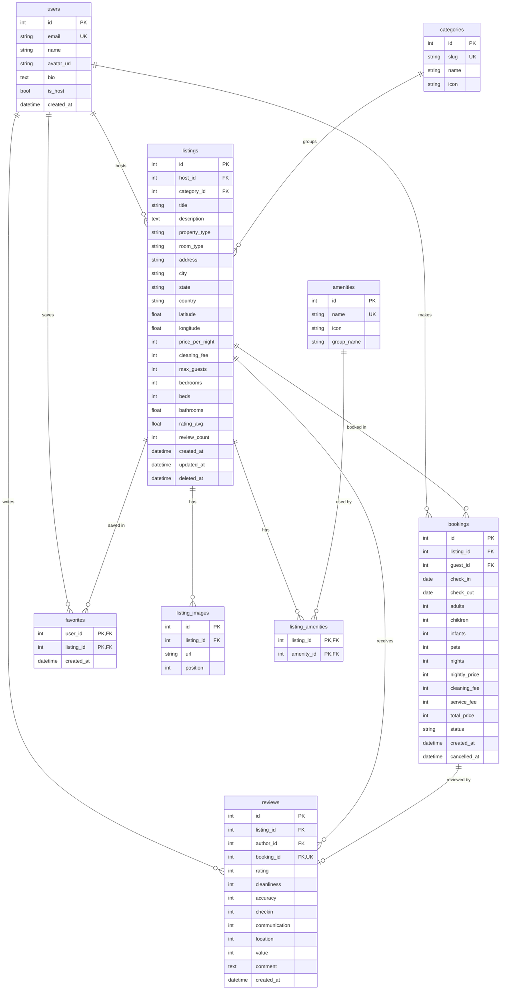

Design notes:

- **Constraints in the database, not only in code:** foreign keys (enabled with `PRAGMA foreign_keys=ON`), `CHECK (check_out > check_in)`, ratings between 1 and 5, a status enum, positive prices, a unique `booking_id` on reviews, and overlap triggers on bookings.
- **Index** `(listing_id, check_in, check_out)` on bookings serves the availability check and search. Other foreign keys and searched columns (city, country, price) are indexed too.
- **Price snapshot:** a booking stores `nightly_price`, fees and total at booking time, so later price edits never change past bookings.
- **Soft delete:** deleting a listing sets `deleted_at` and cancels future bookings. Past bookings and reviews keep their history.
- **Denormalized rating:** `listings.rating_avg` and `review_count` are recomputed whenever a review is written, so search and sorting never aggregate the reviews table.
- **Money** is stored as whole US dollars in integers, which avoids floating point rounding. Fees round to the nearest dollar.
- **Many-to-many:** `listing_amenities` links listings and amenities. `favorites` uses the `(user_id, listing_id)` pair as its primary key, so saving twice is impossible.

---

## API overview

All endpoints are under `/api`. Interactive docs are at `/docs`. 🔒 means the endpoint needs `Authorization: Bearer <token>`.

| Method | Path | Description |
| --- | --- | --- |
| POST | `/auth/login` | Log in with `{email}` and get `{token, user}` (404 if new) |
| POST | `/auth/signup` | Create an account with `{email, name}` |
| GET 🔒 | `/auth/me` | Current user |
| GET | `/categories` · `/amenities` | Lookup data for the UI |
| GET | `/locations?q=` | Destination suggestions for the "Where" field |
| GET | `/price-histogram` | Price distribution for the filters slider |
| GET | `/listings` | Search: `location, check_in, check_out, guests, category, room_type[], property_type[], amenity[], min_price, max_price, bedrooms, beds, bathrooms, page, page_size` |
| GET | `/listings/{id}` | Listing detail with host profile and amenities |
| POST 🔒 | `/listings` | Create a listing (the user becomes a host) |
| PUT 🔒 | `/listings/{id}` | Update a listing (owner only) |
| DELETE 🔒 | `/listings/{id}` | Soft delete and cancel future reservations (owner only) |
| GET | `/listings/{id}/availability` | Booked date ranges |
| GET | `/listings/{id}/quote` | Price breakdown + availability for `check_in, check_out, guests` |
| GET | `/listings/{id}/reviews` | Rating summary + reviews |
| POST 🔒 | `/reviews` | Review a completed stay `{booking_id, rating, ..., comment}` |
| POST 🔒 | `/bookings` | Book `{listing_id, check_in, check_out, adults, children, infants, pets}` |
| GET 🔒 | `/bookings` | My trips |
| GET 🔒 | `/bookings/{id}` | One booking (guest or host only) |
| POST 🔒 | `/bookings/{id}/cancel` | Cancel before check-in (guest or host) |
| GET 🔒 | `/wishlist` | Saved listings |
| POST / DELETE 🔒 | `/wishlist/{listing_id}` | Save / remove (idempotent) |
| GET 🔒 | `/host/listings` | My listings with booking and earnings stats |
| GET 🔒 | `/host/bookings` | Reservations on my listings |
| POST 🔒 | `/uploads` | Upload a photo (JPG/PNG/WEBP/GIF, max 5 MB) and get `{url}` |
| GET | `/health` | Health check |

Error responses look like `{"detail": "Those dates are not available. Please choose different dates."}`.

---

## Deployment

**Backend on Render.** `render.yaml` is a ready-made blueprint: New, then Blueprint, then pick this repository. You can also create a Python web service by hand:

- Root directory: `backend`
- Build command: `pip install -r requirements.txt`
- Start command: `uvicorn app.main:app --host 0.0.0.0 --port $PORT --proxy-headers --forwarded-allow-ips="*"`

**Frontend on Vercel.** Import the repository with root directory `frontend`, and set `NEXT_PUBLIC_API_URL` to the backend URL, for example `https://airbnb-clone-api.onrender.com`.

| Variable | Where | Default | Purpose |
| --- | --- | --- | --- |
| `NEXT_PUBLIC_API_URL` | frontend | `http://localhost:8000` | Backend base URL |
| `SECRET_KEY` | backend | dev value | Signs login tokens. Always set it in production |
| `CORS_ORIGINS` | backend | `*` | Comma-separated allowed origins, e.g. your Vercel URL |
| `DATABASE_URL` | backend | `sqlite:///backend/airbnb.db` | SQLAlchemy database URL |
| `SEED_ON_STARTUP` | backend | `true` | Seed demo data when the database is empty |
| `UPLOAD_DIR` / `PUBLIC_URL` | backend | `backend/uploads` / request URL | Where photos are stored and how their links are built |
| `TOKEN_EXPIRE_DAYS` | backend | `7` | Login token lifetime |

Free hosting tiers usually have an ephemeral disk. The SQLite database and uploaded photos reset on redeploy, and the demo data is re-seeded automatically. Use a persistent disk, or Postgres plus object storage, for anything permanent.

---

## Assumptions and limitations

- **Authentication is mocked:** no passwords, as the brief allows. Tokens are real signed JWTs, so the "who am I" logic is the same as with real auth.
- **Payments are mocked:** the card form comes pre-filled with a test card, is validated in the browser (Luhn check, expiry, CVV) and is never sent to the server.
- **Demo convenience:** first-time visitors are logged in as `guest@demo.com` automatically (see `AUTO_LOGIN_EMAIL`).
- **Placeholders:** messaging, notifications inbox, identity verification, social login, experiences and the host calendar show "Coming soon".
- **Single currency (USD) and one global service fee (14%).** There are no taxes, discounts, minimum stays or host-blocked dates.
- **Dates are calendar dates** in the server's local time zone. Check-in is after 3 PM and checkout before 11 AM.
- **Photos** are Unsplash images referenced by URL. Uploaded photos are stored on the API server's disk.
- **Maps** use free OpenStreetMap tiles through Leaflet, with no API key.
- **Fonts:** Airbnb's own typeface (Cereal) is proprietary, so the app uses Airbnb's fallback system font stack.
- This is a learning project that recreates Airbnb's look and flows. It is not affiliated with Airbnb.
